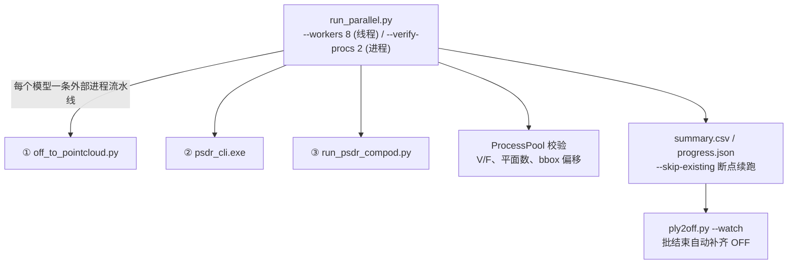

# Windows 原生流水线：OFF → PSDR → COMPOD → 结果 OFF

在不使用 WSL / SageMath 的前提下，在本仓库上跑通「建筑外立面 OFF 输入 → 平面检测与精化（C++ PSDR）→ 平面布置与凸分解（COMPOD）→ 重建多边形网格 PLY → 保 n-gon 的结果 OFF」的完整链路，并支持多线程 + 多进程批处理。

## 1. 总体流程




单模型的一键脚本等价于上面三步串联：

```bash
bash windows_compat/psdr_cpp/run_pipeline.sh data/oblique/anhui/smid_004.off
```

## 2. 环境要求（Windows 原生，无 WSL）

| 依赖 | 说明 |
| --- | --- |
| Python 3.11.7 venv | `windows_compat/.venv`（`gco-wrapper` 需 cp311 wheel，3.13 不可用） |
| pycddlib 3.0.2 | 替代 SageMath 的精确线性代数（`cdd.gmp`） |
| `windows_compat/sage` | `sage.all` 兼容 shim：`Fraction` / 半空间交 / pickle 惰性重建 |
| gco-wrapper cp311 | COMPOD 的 alpha-expansion 优化 |
| C++ PSDR | `psdr_cpp/build/psdr_cli.exe`，CGAL 6 + MSVC + Ninja；需 `CGAL_NO_GMP=1` + `CGAL_DISABLE_GMP=1` |
| vcpkg / Windows SDK | 运行期 PATH 需含 `D:\github\vcpkg\installed\x64-windows\bin` 与 SDK `bin\x64`（批处理脚本已自动注入） |

自检：`python windows_compat/test_compat.py`；demo 验证：`run_demo.py` + `verify_demo.py`（CPU 默认，`COMPOD_DEVICE=cpu`）。

## 3. 目录结构

```
data/oblique/
├── anhui/  moganshan/                              # 旧 margin_4m 源 OFF（49 / 116）
├── vector_p_geometry_20261107/{anhui,moganshan}/   # 矢量裁剪源 OFF（51 / 119）+ manifest.csv
├── result/
│   ├── margin_4m/<tag>/                            # 旧数据每模型工作目录
│   │   ├── pointcloud.ply        # 中心化点云（20 万点）
│   │   ├── center.json           # 平移量，用于坐标还原
│   │   ├── psdr_detected.npz     # 仅检测
│   │   ├── psdr_refined.npz      # 检测 + 精化（COMPOD 的输入）
│   │   └── <tag>_psdr_surface.ply# 重建多边形网格（原始坐标系）
│   └── vector_p_geometry_20261107/<tag>/           # 同上（170 模型）
├── off_recon/{anhui,moganshan}/                    # 矢量裁剪结果 OFF（170）+ manifest_live.csv
└── off_recon_margin_4m/{anhui,moganshan}/          # 旧数据结果 OFF（165）+ manifest.csv
```

## 4. 各阶段说明

### ① OBJ → OFF（可选，源数据不是 OFF 时）

```bash
python windows_compat/obj2off.py --layout flat --jobs 8 \
    --src "E:/github/ObliqueBuilding_Fine_tuning/Data/vector_p_geometry_20261107" \
    --dst data/oblique/vector_p_geometry_20261107
```

`--layout flat` 表示源目录一级子目录即数据集名；`--layout margin` 适配旧的
`.../attempts/<子目录>/margin_4m/*.obj` 多层结构。产物 OFF 全为三角面，另写 `manifest.csv`。

### ② OFF → 点云 PLY

```bash
python windows_compat/off_to_pointcloud.py <in.off> <out.ply> \
    --samples 200000 --center-json <work>/center.json
```

随机采样固定 20 万点并做表面法向估计；同时把场景中心写到 `center.json`。
点云经过中心化是为了 PSDR/COMPOD 的数值稳定性，最后一步再平移回去。

### ③ 点云 → 平面 npz（C++ PSDR）

```bash
windows_compat/psdr_cpp/build/psdr_cli.exe <pointcloud.ply> \
    --out <work>/psdr_refined.npz --detected <work>/psdr_detected.npz \
    --epsilon-ratio 0.01 --min-inliers 120 --knn 10 --normal-th 0.9 \
    [--max-seconds N]        # 0 = 精化到收敛
```

输出 npz 字段：`points / normals / group_parameters / group_colors /
group_points / group_num_points / classes`。平面约定为 **`n·x + d = 0`**
（CGAL 约定；`pycompod` docstring 里写 `n·x = d` 是笔误，与 `_inequalities`
生成的 `[d, a, b, c]` 不符，已用内点与 bunny 样例验证过，无需转换）。

### ④ npz → 重建 PLY（COMPOD + 坐标还原）

```bash
python windows_compat/run_psdr_compod.py --npz <refined.npz> \
    --center-json <center.json> --out <tag>_psdr_surface.ply \
    [--reg-area 0.8] [--no-simplify] [--save-cells]
```

BSP 树构建 → 内外标记 → 简化 → 提取内部单元的界面多边形；输出是
ASCII PLY，`element face` 为 3–21 边的**多边形面**（不是三角面），顶点已按
`center.json` 还原到源 OFF 的原始坐标系。

### ⑤ PLY → 结果 OFF（保 n-gon）

```bash
python windows_compat/ply2off.py \
    --result-root data/oblique/result/vector_p_geometry_20261107 \
    --src-root data/oblique/vector_p_geometry_20261107 \
    --out data/oblique/off_recon [--watch] [--force]
```

面处理规则：

| 情况 | 处理 |
| --- | --- |
| 简单多边形（凸或凹，无洞） | **原样输出 n-gon** |
| 顶点顺序乱但点集凸 | 按质心角序重排后仍输出 n-gon（保持外法向） |
| 自交 / 带洞 / 退化 | Delaunay 三角化 + 面内过滤（洞不会被填平），失败再加质心点扇形化 |
| 零面积 / 非法索引面 | 剔除并计数 |

输出文件名与源 OFF 完全同名，按 `{anhui, moganshan}` 分目录，便于整份加载
做 1:1 对比；`manifest(_live).csv` 记录源/结果 V/F、n-gon 数、三角化与丢面数、
来源 PLY 路径。`--watch` 会在批处理运行期间每 60 s 增量转换，批结束后补齐。

## 5. 批处理与编排

### 并行批（多线程 + 多进程）

```bash
python -u windows_compat/run_parallel.py \
    --off-root data/oblique/vector_p_geometry_20261107 \
    --result-root data/oblique/result/vector_p_geometry_20261107 \
    --workers 8 --verify-procs 2 --stage-timeout 1800 \
    --log-file windows_compat/vector_batch.log
```

- `--workers`：线程数；每个线程驱动一条三阶段**外部进程**流水线，等待子进程
  I/O 时释放 GIL，所以是真并行。
- `--verify-procs`：进程池做 CPU 密集校验（trimesh 统计、npz 平面/内点、
  源 OFF bbox 中心偏移）。
- `summary.csv`（逐模型状态/耗时/规模/偏移/错误）与 `progress.json` 随每模型
  完成而更新；`--skip-existing` 默认开启，中断后重跑即续跑。
- `--dataset` / `--only` / `--limit` 可缩小范围。

### 串行链（先等前一批，再跑另一份数据）

```bash
python -u windows_compat/run_old_batch.py --workers 8 --verify-procs 2
# 加 --no-wait 可跳过等待（手动续跑）
```

阶段 0 等 `vector_p_geometry_20261107` 批 + 其 OFF 转换结束（带 10 分钟无进展
与总超时兜底）→ 阶段 1 对 `data/oblique/{anhui,moganshan}` 旧 OFF 跑流水线 →
阶段 2 转 OFF → 写 `windows_compat/old_batch_report.json`。
所有阶段均可用 `--skip-existing` 断点续跑。

## 6. 结果统计（2026-11-07 全量实测）

| 数据集 | 模型 | 批耗时 | 状态 | 顶点中位 / 最大 | 面中位 / 最大 | PSDR 平面中位 | bbox 偏移中位 | watertight |
| --- | --- | --- | --- | --- | --- | --- | --- | --- |
| vector_p_geometry_20261107 | 170 | 60.7 min | ok 167 + skip 3，0 失败 | 560 / 2018 | 1118 / 4055 | 142（13–335） | 0.349 m | 20/170 |
| 旧 margin_4m | 165 | 60.6 min | ok 165，0 失败 | 646 / 2121 | 1289 / 4247 | 140（7–368） | 0.156 m | 11/165 |

结果 OFF：`off_recon` 170 个（98,269 V / 74,403 F，n-gon 占比 79.8%）、
`off_recon_margin_4m` 165 个（120,414 V / 91,630 F，n-gon 占比 79.5%），
全部共面（最大平面偏差 ≤1.2e-6 m）、索引零错误。逐模型
`Σ(边数−2)` 与 `summary.out_f` 全部相等（仅矢量版 `anhui/smid_036` 差 1，
为剔除的一个零面积退化面），证明转换无几何丢失。

watertight 低是预期：COMPOD 输出的是平面布置内部单元的**边界面片集合**，
不是封闭壳。

## 7. 可视化对比

```bash
python windows_compat/preview_oblique.py <源 OFF> <重建 PLY> ... --html out.html
```

离线 Plotly 单文件：左侧图层默认折叠、右侧 checkbox 开关、线框显示、
重建与源双层透明度滑块。该脚本自带 OFF/PLY 解析器，可正确读 n-gon。

## 8. 已知坑

- **trimesh 5.2 `load_off` 读混合 n-gon OFF 会报错**（`UFuncNoLoopError`）。
  本项目的 `preview_oblique.py` 用自写解析器；外部工具读不了时可改用全三角化副本。
- **被预览面板占用的文件不能写**：`present_files`/预览打开过的 CSV 在 Windows
  上会长期独占，写入方需容错（`ply2off.py` 已处理，权威索引用 `manifest_live.csv`）。
- **脱离会话启动长批被安全策略拦截**：`Start-Process`、WMI、`schtasks` 均不可用，
  只能用会话内托管后台任务；关闭会话会中断批，但 `--skip-existing` 保证续跑。
- bbox 中心偏移 >5 m 的模型值得人工抽查：矢量版 5 个（`moganshan` 的
  smid_017/022/031/033/049，最大 17.8 m），旧数据 3 个（`moganshan` 的
  smid_024/031/033，最大 13.3 m）。
- `pycompod` docstring 的平面方程写法（`n·x = d`）与实际实现（`n·x + d = 0`）不一致，
  以实现为准。

